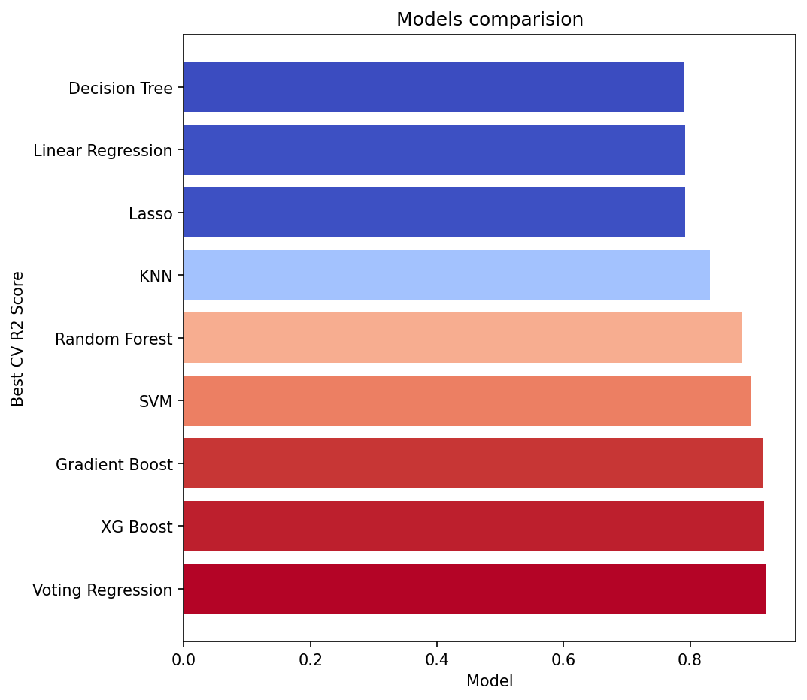
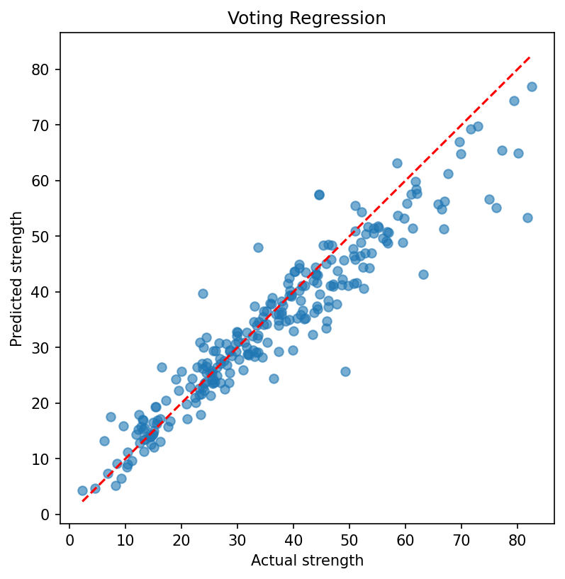
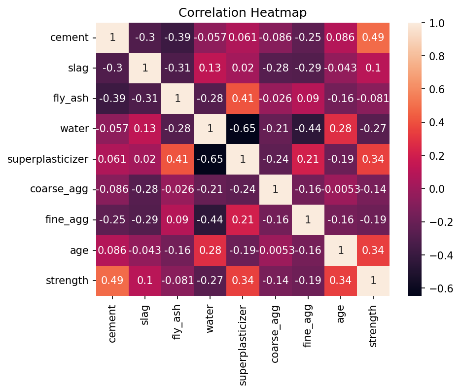
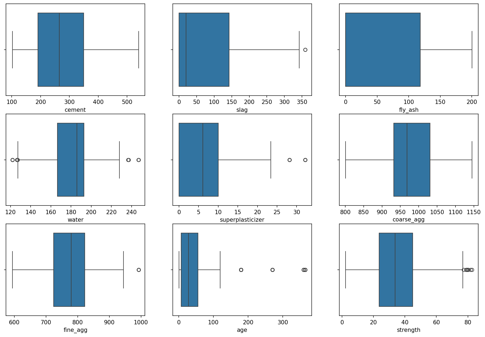
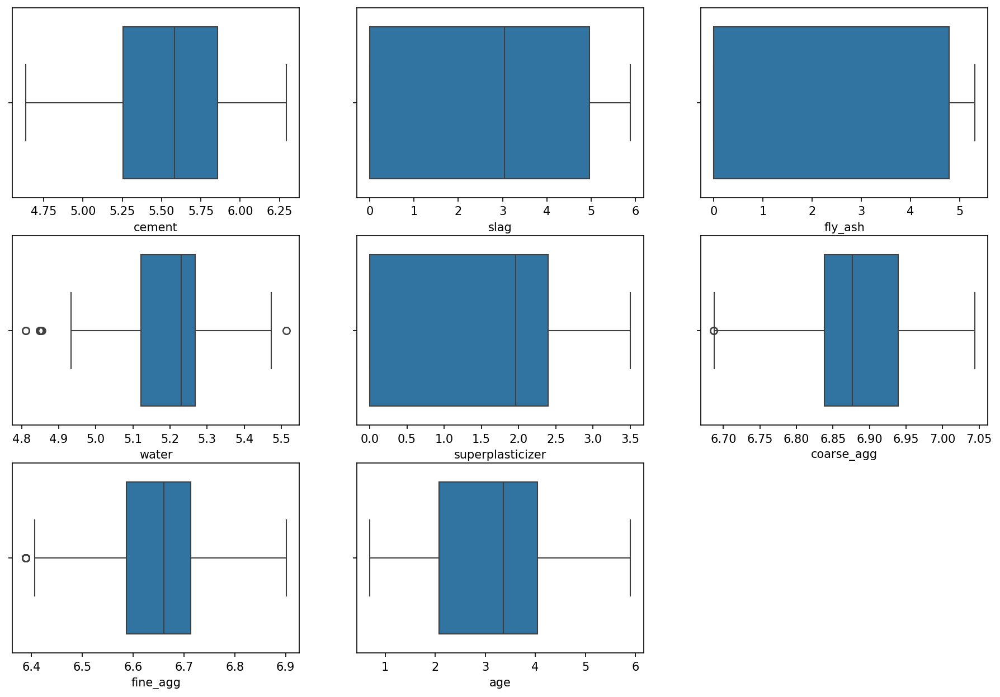

# Concrete Compressive Strength Prediction

Predicting the compressive strength of concrete (in MPa) from its mix composition and age, using machine learning.

The project covers the full workflow: data cleaning, exploratory data analysis, feature transformation, model screening, hyperparameter tuning, an ensemble model, and evaluation on a held-out test set.

## Dataset

- **Source:** UCI Machine Learning Repository, *Concrete Compressive Strength* dataset
- **Size:** 1,030 rows originally, 1,005 after removing duplicates
- **Inputs (8):** cement, blast furnace slag, fly ash, water, superplasticizer, coarse aggregate, fine aggregate (all in kg per m³ of mixture) and age (days)
- **Target:** compressive strength (MPa), ranging from about 2 to 83 MPa

## Workflow

1. **Cleaning:** checked for null values and removed 25 duplicate rows (1,030 to 1,005 rows).
2. **EDA:** univariate (distributions, skew, boxplots), bivariate (each feature vs strength) and correlation analysis.
3. **Outliers:** reviewed rather than deleted. The flagged values (low and high water, high superplasticizer, long curing ages) are physically plausible mixes and carry real information.
4. **Transformation:** applied `log1p` to reduce skew (age was the most skewed column, skew of about 3.3), then standardised the features with `StandardScaler`. The scaler is fit on the training set only.
5. **Train/test split:** 75% / 25% with `random_state=42`. The test set was not used for any model selection.
6. **Model screening:** 8 models compared with 5-fold cross-validation and `RandomizedSearchCV`: Linear Regression, Lasso, KNN, SVR, Decision Tree, Random Forest, Gradient Boosting, XGBoost.
7. **Tuning:** the top 4 models were tuned further with `GridSearchCV`.
8. **Ensemble:** a `VotingRegressor` built from the 4 tuned models.
9. **Final evaluation:** the model with the best cross-validated R² was evaluated once on the test set.

## Key findings from EDA

- **Cement** has the strongest correlation with strength (0.49), followed by **age** and **superplasticizer** (both 0.34). **Water** is negatively correlated with strength (-0.27).
- No single ingredient explains strength (no correlation above 0.5). Strength depends on the combination of ingredients.
- The relationship between age and strength is **curved**: strength rises quickly early on and then flattens. This is why a log transform of age helps.
- Slag, fly ash and superplasticizer contain many zeros. These are mixes that do not use the ingredient, not missing data.
- Water and superplasticizer are negatively correlated (-0.65): high-performance mixes use more superplasticizer and less water.
- Correlations describe the dataset, not cause and effect. Some feature-to-feature correlations may reflect how the experiments were designed.

## Results

### Model comparison (5-fold cross-validated R², training set)

| Model | CV R² | Tuning |
|---|---|---|
| Voting Regression | 0.921114 | grid search (ensemble of tuned models) |
| XGBoost | 0.917614 | grid search |
| Gradient Boosting | 0.914441 | grid search |
| SVR | 0.896263 | grid search |
| Random Forest | 0.881693 | grid search |
| KNN | 0.831701 | random search |
| Linear Regression | 0.792023 | none |
| Lasso | 0.791962 | random search |
| Decision Tree | 0.790689 | random search |

Non-linear models clearly outperform the linear baseline, which matches the curved and non-linear relationships seen in the EDA. The top models score within a narrow range of each other, so small differences between them are within normal fold-to-fold variation.

### Final model on the held-out test set

| Metric | Value |
|---|---|
| Selected model | Voting Regression |
| Test R² | 0.879 |
| Test RMSE | 5.925 MPa |
| Test MAE | 4.151 MPa |

The test R² is slightly lower than the cross-validated R². Some of this gap is expected: the hyperparameters were chosen as the best of many combinations on the same folds, and the test set is fairly small.

## Figures

**Model comparison**



**Predicted vs actual strength (test set)**



**Correlation heatmap**



**Outliers before and after the log transform**




## Repository structure

```
concrete-strength-prediction/
├── README.md
├── requirements.txt
├── .gitignore
├── data/
│   └── Concrete_Data.csv
├── notebooks/
│   └── concrete_strength.ipynb
├── images/
│   └── after_boxplot.png
|   └── before_boxplot.png
|   └── correlation_heatmap.png
|   └── model_comparision.png
|   └── pred_vs_actual.png
└── models/
    └── final_model.pkl
```

## How to run

```bash
git clone https://github.com/YOUR-USERNAME/concrete-strength-prediction.git
cd concrete-strength-prediction
pip install -r requirements.txt
jupyter notebook notebooks/concrete_strength.ipynb
```

You can also open the notebook in Google Colab. Run all cells from top to bottom.

### Saved model

Training and tuning all the models takes a long time, so the notebook checks whether a saved model exists and loads it if so. Otherwise it trains from scratch and saves the result.

- To retrain on purpose, set `retrain = True` or delete `models/final_model.pkl`.
- If you change the data, the split, or any preprocessing step, retrain. A saved model that no longer matches the pipeline will give misleading results.
- The pickle file was created with the library versions listed in `requirements.txt`. Loading it under different scikit-learn or XGBoost versions may fail. Only load pickle files from sources you trust.

## Limitations

- Small dataset (about 1,000 rows) from lab conditions, so the model may not carry over to other cement types, suppliers or curing conditions.
- The test set is small, so the test score has noticeable uncertainty.
- Hyperparameters were tuned with cross-validation on the training set. The cross-validated score is therefore slightly optimistic compared with the test score.
- The model predicts strength from composition and age only. It does not account for factors such as curing temperature or mixing quality.

## Possible future work

- Engineered features such as the water-to-cement ratio and total binder content.
- Nested cross-validation for a less biased comparison of tuned models.
- Bundling the log transform, scaler and model into a single scikit-learn Pipeline so raw mixes can be passed straight to predict.
- Residual analysis, especially for very high-strength mixes.

## Data source and citation

Yeh, I-C. (1998). Modeling of strength of high-performance concrete using artificial neural networks. *Cement and Concrete Research*, 28(12), 1797-1808.

Dataset available from the UCI Machine Learning Repository.
